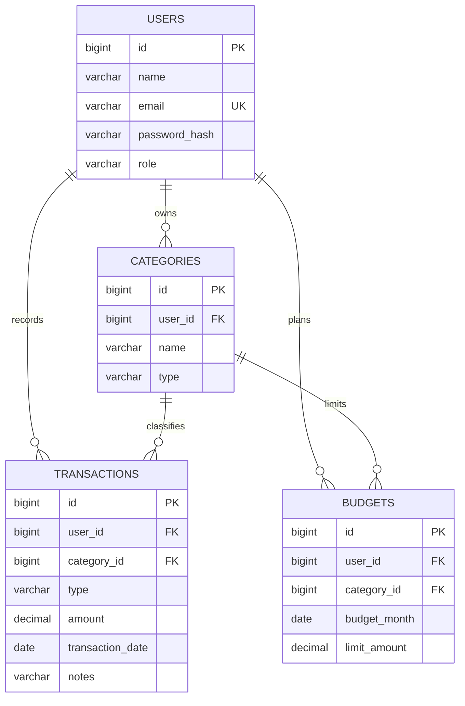

# Relational ER diagram

Constraints: unique `(user_id, name, type)` on categories; unique `(user_id, category_id, budget_month)` on budgets; non-null ownership/category/date/type/amount fields; decimal precision/scale 15,2 for transaction and budget amounts. The application also checks ownership in backend queries. Hibernate `ddl-auto=update` creates/updates the schema for local development.
